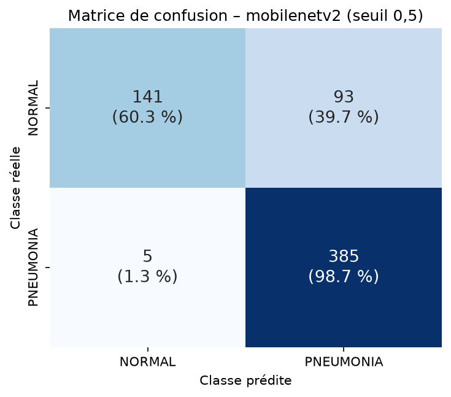
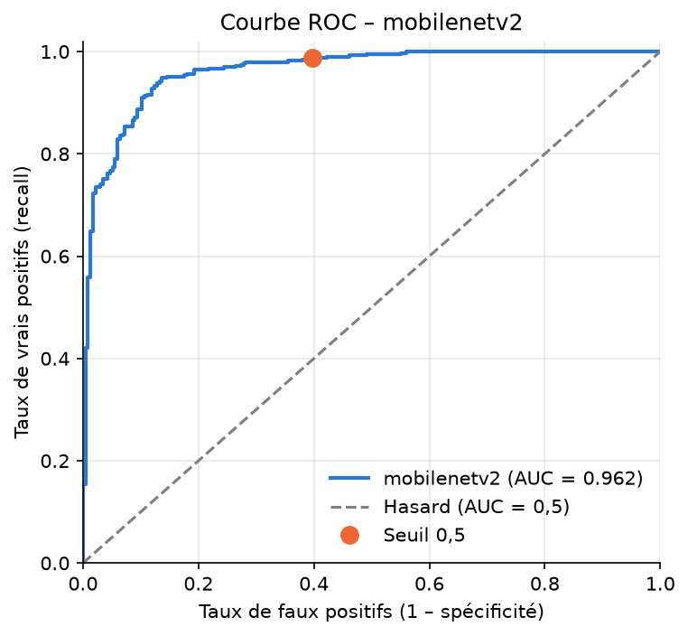
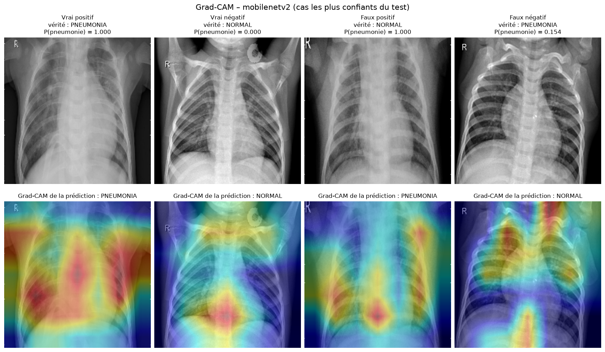
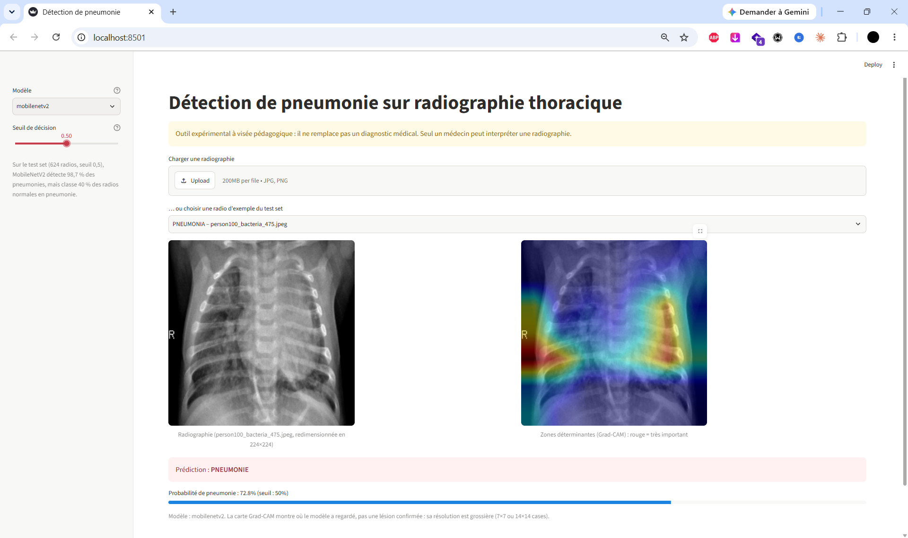
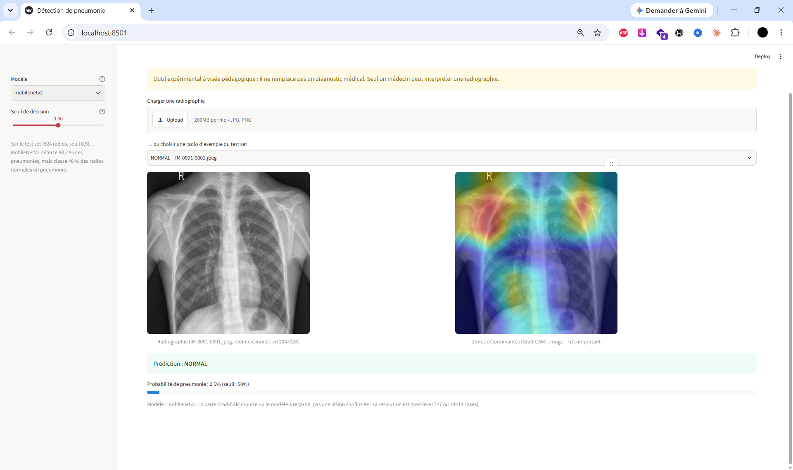

# Détection de pneumonie sur radiographies thoraciques

Projet académique de Deep Learning (5IIR) : classification binaire **NORMAL vs PNEUMONIA** à partir de radiographies
thoraciques d'enfants, avec des CNN pré-entraînés sur ImageNet (MobileNetV2, ResNet50, VGG19), une explication
visuelle des prédictions (Grad-CAM) et une application web Streamlit.

> **Outil pédagogique : il ne remplace pas un diagnostic médical.**

## Objectif

Construire une aide à la lecture de radiographies qui signale les pneumonies, en privilégiant le **recall** : rater un
malade (faux négatif) est plus grave qu'une fausse alerte. Le projet couvre toute la chaîne : préparation des données,
transfer learning et fine-tuning, comparaison de trois architectures, évaluation sur un test set jamais utilisé
pendant l'entraînement, explicabilité et application de démonstration.

## Résultats (test set, 624 radios, seuil 0,5)

| Modèle | Accuracy | Precision | Recall | F1 | AUC | Paramètres | Temps / image (CPU) |
|---|---|---|---|---|---|---|---|
| **MobileNetV2** (retenu) | 84,3 % | 80,5 % | 98,7 % | 0,887 | 0,962 | 2,26 M | ≈ 10 ms |
| ResNet50 | 83,2 % | 80,0 % | 97,4 % | 0,879 | 0,950 | 23,59 M | ≈ 29 ms |
| VGG19 | 84,1 % | 80,2 % | 99,0 % | 0,886 | 0,968 | 20,02 M | ≈ 92 ms |

- Les trois modèles sont à égalité (7 images d'écart sur 624). **MobileNetV2** est retenu : dix fois plus léger et le
  plus rapide.
- MobileNetV2 rate **5 pneumonies sur 390**, mais classe **93 radios normales sur 234** en pneumonie (spécificité 60 %).
- En validation, l'accuracy atteint 96 % : la validation partage des patients avec le train et surestime les
  performances. Les chiffres à retenir sont ceux du test.

| Matrice de confusion (MobileNetV2) | Courbe ROC (MobileNetV2) |
|---|---|
|  |  |



Détail, explications et limites : `docs/etape_4.md` à `docs/etape_7.md`, et le brouillon de rapport `reports/rapport.md`.

## Installation

Python 3.11 recommandé (TensorFlow n'existe pas encore en version stable pour Python 3.14).

```bash
py -3.11 -m venv .venv311       # Linux / macOS : python3.11 -m venv .venv311
.venv311\Scripts\activate       # Linux / macOS : source .venv311/bin/activate
pip install -r requirements.txt
```

Vérifier que TensorFlow fonctionne et s'il voit un GPU :

```bash
python -c "import tensorflow as tf; print(tf.__version__, tf.config.list_physical_devices('GPU'))"
```

Une liste vide `[]` signifie que la machine travaille sur CPU : l'entraînement se fait alors sur Google Colab.

Versions testées : Python 3.11.9, TensorFlow 2.21.0, Keras 3.15.1, NumPy 2.4.6, pandas 2.3.3, scikit-learn 1.9.1,
matplotlib 3.11.2, seaborn 0.13.2, Pillow 13.0.0, OpenCV 5.0.0, Streamlit 1.67.0, kaggle 2.2.5.

## Données

Dataset Kaggle « Chest X-Ray Images (Pneumonia) » (Kermany et al.) : 5 856 radios de face d'enfants.

1. Créer un jeton sur kaggle.com > Settings > API, puis l'enregistrer dans `~/.kaggle/access_token`
   (ou `kaggle.json` pour une clé « legacy »). Ne jamais le mettre dans le projet.
2. Télécharger le dataset, puis refaire le split train / val / test :

```bash
python -m kaggle datasets download -d paultimothymooney/chest-xray-pneumonia -p data/raw --unzip
python src/split_data.py
```

L'archive contient un dossier en double (`chest_xray/chest_xray`) et un dossier `__MACOSX` : on ne garde que
`data/raw/chest_xray/` avec ses sous-dossiers `train`, `val` et `test`.

Le dossier `val` d'origine ne contient que 16 images : `split_data.py` fusionne `train` et `val` puis refait un split
stratifié 85 / 15 (seed 42). Le test d'origine est gardé intact.

| Split | Images | NORMAL | PNEUMONIA |
|---|---|---|---|
| train | 4 447 | 1 147 | 3 300 |
| val | 785 | 202 | 583 |
| test | 624 | 234 | 390 |

L'exploration (répartition des classes, exemples de radios) est dans `notebooks/01_exploration.ipynb`.

Tester le pipeline de données (9 images augmentées dans `reports/figures/augmentation.png` et poids des classes) :

```bash
python src/data.py
```

## Entraînement

```bash
python src/train.py --model mobilenetv2 --epochs2 0    # phase 1 seule (base gelée)
python src/train.py --model resnet50                   # phase 1 + fine-tuning
```

Options : `--model` (`mobilenetv2`, `resnet50`, `vgg19`), `--epochs1` (15 par défaut), `--epochs2` (10 par défaut, 0 = pas de fine-tuning).

Le script produit dans `models/` le modèle final (`<modèle>.keras`), le meilleur modèle de chaque phase et
les historiques (`<modèle>_phase1_history.csv`, `<modèle>_phase2_history.csv`), et dans `reports/figures/` les courbes
(`courbes_<modèle>.png`).

Sans GPU, utiliser `notebooks/colab_train.ipynb` sur Google Colab (Exécution > Modifier le type d'exécution > GPU T4).
Ce notebook est prévu pour Colab uniquement : ne pas l'exécuter sur le PC. Les trois modèles de l'étape 4 ont été
entraînés de cette façon.

**Les fichiers `.keras` ne sont pas dans le dépôt** (22 à 210 Mo chacun) : il faut les entraîner, ou les récupérer
séparément, avant de lancer les scripts suivants et l'application.

## Comparaison des modèles

```bash
python src/compare.py
```

Évalue sur le test set tous les modèles présents dans `models/` et produit `reports/comparaison.csv`
(accuracy, precision, recall, F1, AUC, nombre de paramètres, temps d'inférence par image) ainsi que
`reports/figures/comparaison_modeles.png`.

## Évaluation détaillée

```bash
python src/evaluate.py --model mobilenetv2
```

Évalue un modèle sur le test set et produit :

- `reports/rapport_<modèle>.txt` : precision, recall et F1 par classe ;
- `reports/seuils_<modèle>.csv` : recall, precision, faux négatifs et faux positifs pour les seuils 0,3 à 0,7 ;
- dans `reports/figures/` : matrice de confusion (`cm_`), courbe ROC (`roc_`), courbe précision-rappel (`pr_`),
  et les erreurs les plus confiantes (`erreurs_fn_`, `erreurs_fp_`).

## Explicabilité (Grad-CAM)

```bash
python src/gradcam.py --model mobilenetv2
```

Produit dans `reports/figures/` les cartes de chaleur Grad-CAM de 4 cas du test (vrai positif, vrai négatif,
faux positif, faux négatif) dans `gradcam_<modèle>.png`, et des 4 faux positifs les plus confiants dans
`gradcam_fp_<modèle>.png`. Rouge = zone qui a le plus pesé dans la décision.

## Application Streamlit

Depuis la racine du projet, environnement activé :

```bash
streamlit run app/app.py
```

Si la commande `streamlit` est bloquée par Windows (contrôle d'application), utiliser :

```bash
python -m streamlit run app/app.py
```

L'application s'ouvre sur http://localhost:8501 (le premier chargement prend environ 15 secondes).
Barre latérale : choix du modèle (parmi ceux présents dans `models/`) et du seuil de décision.
Page principale : chargement d'une radio JPEG ou PNG, ou choix d'une radio d'exemple du test set ;
l'application affiche la radio, la carte Grad-CAM, la prédiction et la probabilité de pneumonie.

### Captures d'écran

 À compléter : enregistrer les captures dans reports/figures/ sous ces noms, puis enlever les balises de commentaire.




*Captures à ajouter : `reports/figures/app_pneumonie.png`, `app_normal.png`, `app_seuil_1.png`,`app_seuil_2.png`
(cas conseillés dans `docs/etape_7.md`).*

## Structure du projet

```
├── CLAUDE.md             # instructions permanentes pour Claude Code
├── README.md
├── requirements.txt      # dépendances Python
├── data/                 # dataset (non versionné)
│   ├── raw/chest_xray/   # dataset Kaggle d'origine
│   └── processed/        # train / val / test refaits
├── src/
│   ├── config.py         # constantes : chemins, taille d'image, seed 42...
│   ├── split_data.py     # étape 1 : nouveau split stratifié
│   ├── data.py           # étape 2 : pipeline tf.data, augmentation, poids des classes
│   ├── models.py         # étapes 3-4 : construction des modèles, fine-tuning
│   ├── train.py          # étapes 3-4 : entraînement en deux phases, courbes
│   ├── compare.py        # étape 4 : comparaison des modèles sur le test
│   ├── evaluate.py       # étape 5 : évaluation détaillée
│   └── gradcam.py        # étape 6 : Grad-CAM
├── app/app.py            # étape 7 : application Streamlit
├── notebooks/            # exploration + notebook d'entraînement Colab
├── models/               # modèles .keras (non versionnés) et historiques .csv
├── reports/
│   ├── figures/          # toutes les figures
│   ├── comparaison.csv, rapport_*.txt, seuils_*.csv
│   ├── rapport.md        # brouillon du rapport
│   └── plan_soutenance.md
└── docs/                 # une fiche expliquée par étape (etape_0.md à etape_8.md)
```

## Avancement

- [x] Étape 0 – Environnement et structure
- [x] Étape 1 – Données : téléchargement et nouveau split
- [x] Étape 2 – Pipeline de données, augmentation, poids des classes
- [x] Étape 3 – Modèle de base et entraînement (transfer learning)
- [x] Étape 4 – Fine-tuning et comparaison des 3 modèles
- [x] Étape 5 – Évaluation complète
- [x] Étape 6 – Explicabilité avec Grad-CAM
- [x] Étape 7 – Application Streamlit
- [x] Étape 8 – Rapport, README et soutenance (brouillons à relire)
