# Détection de pneumonie sur radiographies thoraciques par transfer learning

*Brouillon de rapport – projet de Deep Learning, 5IIR*

> **À lire avant d'utiliser ce brouillon.** Tous les chiffres sur nos résultats viennent des fichiers du projet
> (`reports/comparaison.csv`, `reports/seuils_*.csv`, `reports/rapport_*.txt`, `models/*_history.csv`,
> `docs/etape_*.md`). Les informations venant de la littérature (dates, auteurs, chiffres de l'OMS) sont marquées
> **[à vérifier]** : elles doivent être contrôlées dans la source originale et citées correctement avant le rendu.
> Les encadrés « Point faible » signalent ce qu'un jury pourrait relever. Ce texte est un brouillon : relis-le,
> reformule-le avec tes mots, et complète-le pour atteindre la longueur demandée.

---

## Résumé

Nous avons entraîné et comparé trois réseaux de neurones convolutionnels pré-entraînés sur ImageNet (MobileNetV2,
ResNet50 et VGG19) pour distinguer les radiographies thoraciques normales des radiographies de pneumonie, sur le
dataset pédiatrique de Kermany et al. (5 856 images). Après un nouveau découpage des données, chaque modèle est
entraîné en deux phases : base gelée, puis fine-tuning du dernier bloc. Sur le test set (624 radios jamais vues), les
trois modèles obtiennent des performances équivalentes : accuracy de 83,2 % à 84,3 %, recall de 97,4 % à 99,0 %,
AUC de 0,950 à 0,968. Nous retenons MobileNetV2 (2,26 millions de paramètres, environ 10 ms par image sur CPU), qui
ne rate que 5 pneumonies sur 390 mais produit 93 fausses alertes sur 234 radios normales. L'analyse par Grad-CAM
montre que le modèle regarde surtout le thorax, mais pas toujours les poumons, et révèle chez VGG19 un appui ponctuel
sur un marqueur de l'image. Une application Streamlit permet de tester les modèles sur une radio. Nous discutons
l'écart entre validation (96 %) et test (84 %), les biais du dataset et les conditions qu'il faudrait réunir avant
tout usage clinique.

**Mots-clés :** apprentissage profond, transfer learning, CNN, radiographie thoracique, pneumonie, Grad-CAM.

---

## 1. Introduction et problématique

### 1.1 La pneumonie

La pneumonie est une infection des poumons : les alvéoles se remplissent de liquide ou de pus, ce qui gêne la
respiration. Elle peut être d'origine bactérienne ou virale. Chez l'enfant, c'est l'une des principales causes de
décès d'origine infectieuse dans le monde, en particulier avant 5 ans **[à vérifier : chiffres de l'OMS, fiche
« Pneumonie »]**.

La radiographie thoracique est l'examen le plus utilisé pour la confirmer. Sur une radio, une pneumonie apparaît en
général comme une zone plus blanche (opacité) dans un poumon qui devrait être sombre, car rempli d'air.

### 1.2 Pourquoi une aide au diagnostic ?

La lecture d'une radiographie demande un radiologue expérimenté, qui n'est pas toujours disponible, surtout dans les
régions où les médecins sont peu nombreux. Un outil automatique pourrait :

- **trier** les examens, en signalant en priorité ceux qui sont suspects ;
- servir de **second avis** au médecin ;
- **réduire le délai** entre l'examen et la prise en charge.

### 1.3 Problématique

> Un réseau de neurones pré-entraîné sur des photos ordinaires peut-il apprendre, avec quelques milliers de radios,
> à détecter une pneumonie avec un recall élevé ? Et peut-on comprendre sur quoi il fonde sa décision ?

Le critère principal est le **recall** (part des pneumonies détectées), car un malade non détecté est l'erreur la
plus grave. Nous suivons aussi la precision, la spécificité, le F1, l'AUC, la taille des modèles et leur vitesse.

### 1.4 Contributions

1. Un nouveau découpage des données, stratifié et reproductible (seed 42), avec une analyse de ses limites.
2. Un protocole d'entraînement identique pour trois architectures, en deux phases (base gelée puis fine-tuning).
3. Une évaluation complète sur le test set : matrice de confusion, courbes ROC et précision-rappel, effet du seuil,
   analyse des erreurs.
4. Une analyse d'explicabilité par Grad-CAM, avec une correction du calcul pour les prédictions saturées.
5. Une application web de démonstration.

---

## 2. État de l'art

### 2.1 Les réseaux convolutionnels (CNN)

Un CNN applique à l'image une succession de **filtres** (convolutions) qui détectent des motifs de plus en plus
complexes : des bords et des textures dans les premières couches, des formes puis des objets dans les dernières. Des
couches de **pooling** réduisent la taille des cartes en gardant l'essentiel. Une dernière partie transforme ces
caractéristiques en réponse. Les CNN se sont imposés en vision par ordinateur après la compétition ImageNet de 2012
**[à vérifier : AlexNet, Krizhevsky et al., 2012]**.

Les trois architectures que nous comparons représentent trois générations :

| Architecture | Idée principale | Référence |
|---|---|---|
| **VGG19** | Empiler de nombreuses petites convolutions 3×3 : simple mais lourd | Simonyan et Zisserman, 2015 **[à vérifier]** |
| **ResNet50** | Connexions résiduelles (« raccourcis ») qui permettent d'entraîner des réseaux très profonds | He et al., 2016 **[à vérifier]** |
| **MobileNetV2** | Convolutions séparables et blocs « inversés » : très léger, conçu pour les téléphones | Sandler et al., 2018 **[à vérifier]** |

### 2.2 Le transfer learning

Entraîner un CNN à partir de zéro demande des centaines de milliers d'images annotées. Le **transfer learning**
réutilise un réseau déjà entraîné sur une grande base, ici ImageNet (environ 1,2 million de photos réparties en 1 000
classes **[à vérifier]**), et l'adapte à une nouvelle tâche. Les premières couches, qui détectent des motifs
généraux, restent utiles même pour des radiographies. On remplace la dernière couche par une sortie adaptée, puis on
peut **réajuster** (fine-tuning) les dernières couches avec un learning rate faible.

### 2.3 Deep learning et radiographie thoracique

- **Kermany et al. (2018)** **[à vérifier : revue Cell]** ont publié le dataset que nous utilisons et montré qu'un CNN
  pré-entraîné pouvait détecter la pneumonie chez l'enfant sur ces radiographies.
- **CheXNet (Rajpurkar et al., 2017)** **[à vérifier]** : un DenseNet de 121 couches entraîné sur ChestX-ray14, une base
  d'environ 112 000 radiographies d'adultes annotées pour 14 pathologies **[à vérifier]**. Les auteurs ont comparé ses
  performances sur la pneumonie à celles de radiologues.
- Plusieurs travaux ont ensuite montré que ces modèles peuvent **s'appuyer sur des indices parasites** (marqueurs,
  texte, type d'appareil, hôpital d'origine) et généraliser mal d'un hôpital à l'autre **[à vérifier : par exemple
  Zech et al., 2018]**. C'est une des raisons de l'intérêt pour l'explicabilité.

### 2.4 Explicabilité : Grad-CAM

**Grad-CAM** (Selvaraju et al., 2017 **[à vérifier]**) produit une carte de chaleur des zones de l'image qui ont le plus
contribué à une décision. Elle utilise les gradients du score de la classe par rapport aux cartes de la dernière
couche convolutionnelle. Elle ne demande aucune modification du modèle, ce qui la rend facile à appliquer à n'importe
quel CNN.

---

## 3. Données

### 3.1 Le dataset

Nous utilisons le dataset « Chest X-Ray Images (Pneumonia) » diffusé sur Kaggle, issu des travaux de Kermany et al. :
**5 856 radiographies thoraciques de face** d'enfants, réparties en deux classes, NORMAL et PNEUMONIA (pneumonies
bactériennes et virales confondues). Les images viennent d'un seul centre hospitalier **[à vérifier : centre médical
pour femmes et enfants de Guangzhou, Chine]**.

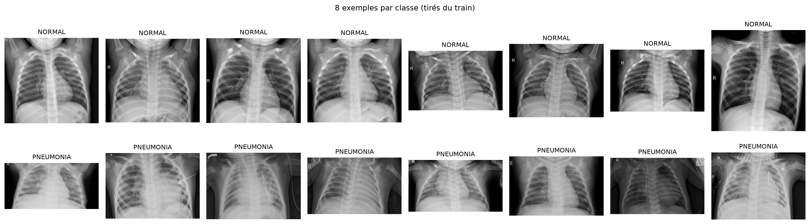

*Figure 1 – Exemples de radiographies NORMAL et PNEUMONIA (`figures/exemples_radios.png`).*

Caractéristiques observées (sur un échantillon de 300 images) :

- **Tailles très variées** : de 450×234 à 2 619×2 628 pixels, médiane 1 272×888.
- **Format** : 286 images sur 300 en niveaux de gris, 14 en couleur (RGB).

### 3.2 Un découpage d'origine inutilisable

Le découpage fourni comporte un dossier de validation de seulement **16 images**. Avec si peu d'images, une seule
erreur fait varier l'accuracy de 6 points : l'arrêt anticipé et le choix du modèle se feraient au hasard.

Nous avons donc fusionné `train` et `val`, puis refait un découpage **stratifié** 85 % / 15 % avec une seed fixe (42).
Le **test d'origine est gardé intact** : il ne sert qu'à l'évaluation finale.

| Split | Avant | Après | NORMAL | PNEUMONIA | Part de pneumonies |
|---|---|---|---|---|---|
| train | 5 216 | **4 447** | 1 147 | 3 300 | 74,2 % |
| val | 16 | **785** | 202 | 583 | 74,3 % |
| test | 624 | **624** | 234 | 390 | 62,5 % |
| Total | 5 856 | 5 856 | 1 583 | 4 273 | |

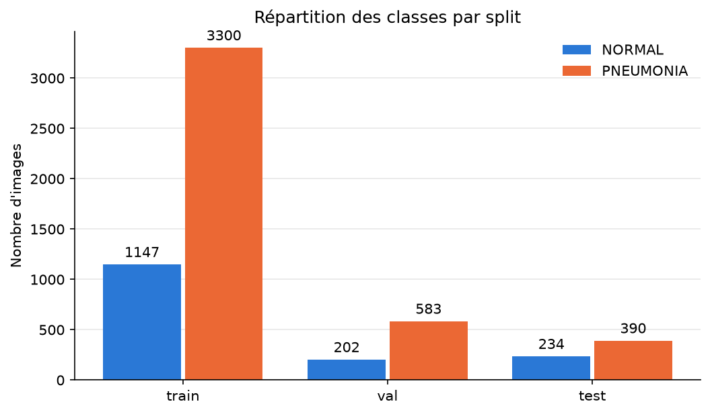

*Figure 2 – Répartition des classes après le nouveau découpage (`figures/repartition_classes.png`).*

Vérifications : aucune image perdue, aucun fichier en commun entre les trois jeux, 14,97 % des NORMAL et 15,01 % des
PNEUMONIA envoyés en validation, découpage identique à chaque lancement.

### 3.3 Déséquilibre des classes

Le train contient **74 % de pneumonies**, soit environ 2,9 pneumonies pour une radio normale. Un modèle qui répondrait
toujours « pneumonie » aurait déjà 74 % d'accuracy. Nous compensons de trois façons :

1. **Découpage stratifié** : même proportion dans train et validation.
2. **Poids de classes** dans la fonction de perte : `poids = total / (2 × effectif de la classe)`, soit
   **1,94 pour NORMAL et 0,67 pour PNEUMONIA**. Une erreur sur une radio normale compte 2,9 fois plus.
3. **Métriques adaptées** : recall, precision, spécificité, F1 et AUC plutôt que la seule accuracy.

> **Point faible.** Le test n'a pas la même proportion de classes que le train (62,5 % de pneumonies contre 74,2 %).
> Ce décalage contribue aux nombreuses fausses alertes observées sur le test (section 5).

### 3.4 Prétraitement

Toutes les images passent par le même pipeline `tf.data` :

1. lecture et conversion en **3 canaux** (les radios en gris sont dupliquées sur les canaux rouge, vert et bleu, car
   les modèles ImageNet attendent des images couleur) ;
2. redimensionnement en **224×224** (interpolation bilinéaire) ;
3. regroupement par **lots de 32** ;
4. normalisation propre à chaque modèle (`preprocess_input`) : valeurs entre −1 et 1 pour MobileNetV2, centrage sur
   les moyennes d'ImageNet pour ResNet50 et VGG19.

### 3.5 Augmentation des données

Sur le **train uniquement**, des transformations aléatoires créent des variantes des images à chaque epoch :

| Transformation | Amplitude | Ce qu'elle simule |
|---|---|---|
| Rotation | ±10° | Patient légèrement penché |
| Zoom | ±10 % | Distance variable au détecteur |
| Translation | ±5 % | Patient mal centré |
| Contraste | ±10 % | Réglages d'exposition différents |

Nous n'utilisons **pas de symétrie** (flip) : le cœur est à gauche du patient, et une radio inversée ne serait pas
réaliste.

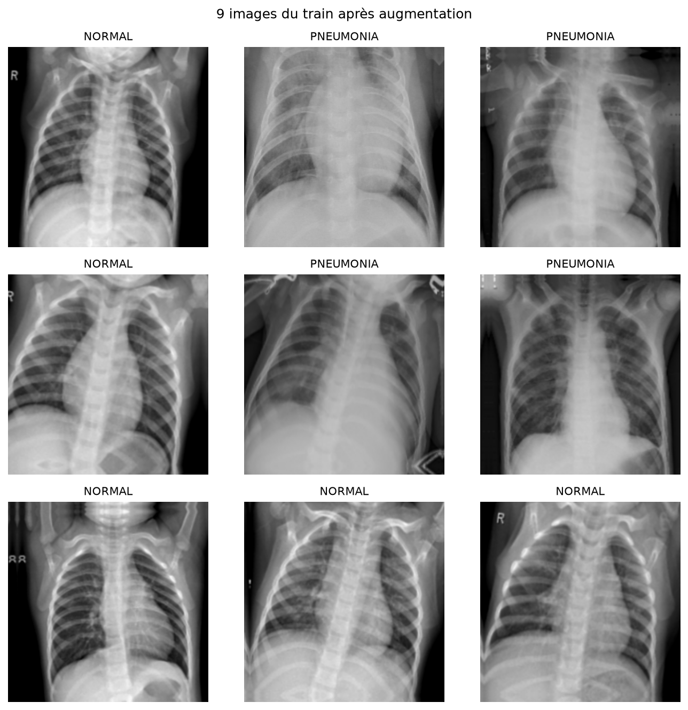

*Figure 3 – Neuf radios du train après augmentation (`figures/augmentation.png`).*

### 3.6 Limites des données

> **Point faible – fuite par patient dans la validation.** Le découpage est fait image par image, pas patient par
> patient. Or un patient a souvent plusieurs radios. Résultat mesuré : **362 des 467 patients atteints de pneumonie
> de la validation ont aussi des radios dans le train** (468 images sur 583). La validation est donc trop facile, ce
> qui explique en partie l'écart validation / test (section 5.5). Le test n'est pas concerné par ce problème.

> **Point faible – doublons.** Le dataset contient 5 824 contenus distincts pour 5 856 fichiers. 9 images strictement
> identiques sont présentes à la fois dans le train et la validation. Aucune n'est commune avec le test.

> **Point faible – indépendance du test.** 155 identifiants `personN` existent à la fois dans le train et le test. Les
> noms de fichiers ne permettent pas de savoir s'il s'agit des mêmes patients ; les auteurs décrivent le test comme
> indépendant.

> **Point faible – images déformées.** Le redimensionnement en 224×224 ne conserve pas les proportions des radios
> (médiane 1 272×888) : elles sont légèrement étirées. Le traitement est le même pour tous les jeux.

---

## 4. Méthode

### 4.1 Architecture des modèles

Les trois modèles partagent la même structure :

```
Image 224×224×3
   → backbone pré-entraîné sur ImageNet, sans sa couche de sortie
   → Global Average Pooling (une valeur par carte de caractéristiques)
   → Dropout 30 %
   → Dense(1, sigmoïde) : probabilité de PNEUMONIA
```

| Modèle | Paramètres au total | Entraînables en phase 1 | Entraînables en phase 2 | Dernière couche convolutionnelle |
|---|---|---|---|---|
| MobileNetV2 | 2 259 265 | 1 281 | 1 512 001 (67 %) | `out_relu`, 7×7×1 280 |
| ResNet50 | 23 589 761 | 2 049 | 14 430 721 (61 %) | `conv5_block3_out`, 7×7×2 048 |
| VGG19 | 20 024 897 | 513 | 9 439 745 (47 %) | `block5_conv4`, 14×14×512 |

Le backbone est branché directement sur l'entrée du modèle (`input_tensor`), pour que ses couches restent accessibles
par leur nom (nécessaire pour Grad-CAM).

### 4.2 Entraînement en deux phases

**Phase 1 – base gelée.** Seule la tête (Dropout + Dense) apprend. Learning rate de 0,001, au plus 15 epochs.
La tête part de poids aléatoires : si la base était dégelée dès le début, ses grosses erreurs abîmeraient les poids
pré-entraînés.

**Phase 2 – fine-tuning.** On dégèle environ le **dernier bloc** de chaque backbone, puis on recompile avec un learning
rate **100 fois plus faible** (0,00001), au plus 10 epochs. Les couches **BatchNormalization restent gelées** : leurs
statistiques, calculées sur ImageNet, seraient instables si elles étaient recalculées sur des lots de 32 radios.

| Modèle | Couches dégelées en phase 2 | Ce que cela représente |
|---|---|---|
| MobileNetV2 | 30 | blocs 14 à 16 et dernière convolution |
| ResNet50 | 30 | l'étage `conv5` |
| VGG19 | 5 | le bloc 5 (4 convolutions) |

Le guide de référence prévoyait 30 couches pour tous les modèles. Or VGG19 n'a que 22 couches : avec 30, toute sa base
(20 millions de paramètres) aurait été réentraînée. Nous avons donc choisi de dégeler le dernier bloc de chacun.

Vérifications faites sur un mini-entraînement : le learning rate passe bien de 0,001 à 0,00001, aucune couche
BatchNorm n'est modifiée, et les couches modifiées pendant la phase 2 sont exactement celles qui ont été dégelées.

### 4.3 Hyperparamètres

| Paramètre | Valeur |
|---|---|
| Taille d'image | 224×224×3 |
| Taille de lot | 32 |
| Optimiseur | Adam |
| Learning rate | 0,001 (phase 1), 0,00001 (phase 2) |
| Fonction de perte | Entropie croisée binaire, pondérée par les poids de classes |
| Dropout | 0,3 |
| Epochs maximum | 15 (phase 1) + 10 (phase 2) |
| Arrêt anticipé | `val_loss`, patience 5, retour aux meilleurs poids |
| Réduction du learning rate | × 0,2 si `val_loss` stagne 2 epochs, minimum 10⁻⁷ |
| Seed | 42 (Python, NumPy, TensorFlow, découpage, augmentation) |

### 4.4 Environnement

Le PC de développement n'a pas de GPU utilisable par TensorFlow (GPU AMD intégré ; TensorFlow ne gère plus le GPU
sous Windows natif depuis la version 2.11). La phase 1 de MobileNetV2 a été entraînée sur le processeur (environ
58 minutes pour 15 epochs). Les trois modèles complets ont été entraînés sur **Google Colab (GPU T4)**, avec
TensorFlow 2.21.0, à partir du même code cloné depuis GitHub. L'évaluation, Grad-CAM et l'application tournent sur le
PC (Python 3.11.9, TensorFlow 2.21.0, Keras 3.15.1).

> **Point faible.** Chaque modèle n'a été entraîné qu'**une seule fois**. Avec une autre seed, les résultats
> varieraient un peu ; les écarts entre modèles observés au test sont plus petits que cette variation probable.

---

## 5. Résultats

### 5.1 Entraînement

Meilleure epoch de chaque phase (plus petite loss de validation). **Chiffres de validation**, qui servent seulement
à piloter l'entraînement :

| Modèle | Phase | Epochs faites | Meilleure epoch | Loss val | Accuracy val | Recall val | AUC val |
|---|---|---|---|---|---|---|---|
| MobileNetV2 | 1 | 15 | 13 | 0,104 | 96,2 % | 96,4 % | 0,991 |
| MobileNetV2 | 2 | 6 | 1 | **0,093** | 96,4 % | 96,4 % | 0,993 |
| ResNet50 | 1 | 8 | 3 | 0,105 | 95,4 % | 95,0 % | 0,993 |
| ResNet50 | 2 | 6 | 1 | **0,084** | 96,8 % | 96,2 % | 0,997 |
| VGG19 | 1 | 11 | 6 | 0,131 | 95,2 % | 94,3 % | 0,990 |
| VGG19 | 2 | 7 | 2 | **0,084** | 96,6 % | 95,9 % | 0,997 |

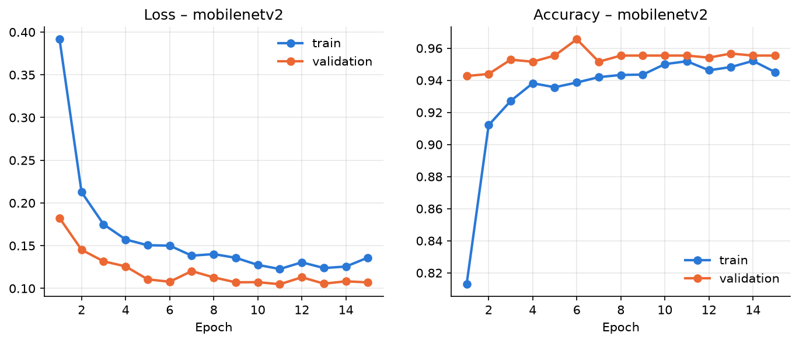

*Figure 4 – Loss et accuracy de MobileNetV2 ; le trait vertical marque le début du fine-tuning
(`figures/courbes_mobilenetv2.png`, voir aussi `courbes_resnet50.png` et `courbes_vgg19.png`).*

Observations :

- **Le fine-tuning améliore la loss de validation des trois modèles**, surtout pour VGG19 (de 0,131 à 0,084).
- **L'arrêt anticipé s'est déclenché dans toutes les phases 2** (6 ou 7 epochs sur 10), avec une meilleure epoch
  très précoce (1 ou 2).
- **Après le début du fine-tuning, la loss d'entraînement chute** (ResNet50 : de 0,110 à 0,041 ; VGG19 : de 0,136 à
  0,035), alors que la loss de validation oscille (ResNet50 : 0,084 puis 0,164, 0,185, 0,109…). C'est un **début de
  surapprentissage**, limité par l'arrêt anticipé qui restaure les poids de la meilleure epoch.
- En phase 1, la validation est meilleure que l'entraînement : les métriques d'entraînement sont mesurées avec le
  dropout actif, sur des images augmentées et avec une loss pondérée, et la validation partage des patients avec le
  train.

### 5.2 Comparaison des trois modèles sur le test

Test set : 624 radios jamais utilisées pendant l'entraînement, seuil de décision 0,5.

| Modèle | Accuracy | Precision | Recall | Spécificité | F1 | AUC | AP | Paramètres | Fichier | Temps / image (CPU) |
|---|---|---|---|---|---|---|---|---|---|---|
| **MobileNetV2** | 84,3 % | 80,5 % | 98,7 % | 60,3 % | 0,887 | 0,962 | 0,975 | 2,26 M | 22 Mo | ≈ 10 ms |
| ResNet50 | 83,2 % | 80,0 % | 97,4 % | 59,4 % | 0,879 | 0,950 | 0,965 | 23,59 M | 210 Mo | ≈ 29 ms |
| VGG19 | 84,1 % | 80,2 % | 99,0 % | 59,4 % | 0,886 | 0,968 | 0,980 | 20,02 M | 156 Mo | ≈ 92 ms |

| Modèle | Vrais positifs | Faux négatifs | Vrais négatifs | Faux positifs |
|---|---|---|---|---|
| MobileNetV2 | 385 | 5 | 141 | 93 |
| ResNet50 | 380 | 10 | 139 | 95 |
| VGG19 | 386 | 4 | 139 | 95 |

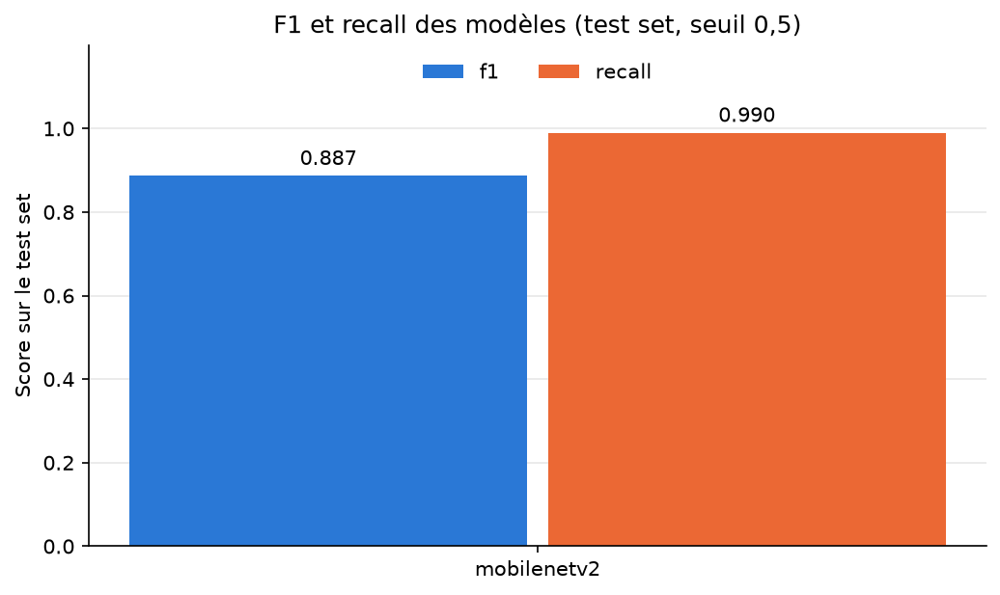

*Figure 5 – F1 et recall des trois modèles sur le test (`figures/comparaison_modeles.png`).*

**Les trois modèles sont à égalité.** Entre le meilleur et le moins bon, l'écart est de 7 images sur 624. Avec
624 images, l'incertitude sur une accuracy est de l'ordre de ± 3 points : un écart de 1 point n'est pas significatif.

**Choix de MobileNetV2.** À performance égale, nous retenons le modèle le plus simple : dix fois moins de paramètres,
un fichier de 22 Mo au lieu de 156 à 210 Mo, et environ 3 fois plus rapide que ResNet50 et 9 fois plus que VGG19 sur
processeur. Il est le mieux adapté à une application légère.

> **Point faible.** Le temps par image a été mesuré sur le processeur du PC (lots de 32) : c'est un ordre de grandeur
> qui dépend de la machine. Par ailleurs, choisir un modèle en regardant le test introduit un léger biais ; il est
> limité ici car les scores sont à égalité et le choix repose sur la taille et la vitesse.

**Apport du fine-tuning sur le test.** Pour MobileNetV2, le seul modèle dont on a aussi évalué une version sans
fine-tuning (entraînée sur le PC à l'étape 3), les résultats sont identiques à une image près :

| MobileNetV2 | Accuracy | Precision | Recall | F1 | AUC |
|---|---|---|---|---|---|
| Phase 1 seule | 84,3 % | 80,4 % | 99,0 % | 0,887 | 0,962 |
| Après fine-tuning | 84,3 % | 80,5 % | 98,7 % | 0,887 | 0,962 |

Le fine-tuning améliore la validation mais pas le test. Explication probable : il s'arrête dès la première ou la
deuxième epoch avec un learning rate très faible, donc les poids bougent peu, et la principale difficulté du test
(le décalage avec le train) ne se corrige pas en réentraînant sur les mêmes images.

> **Point faible.** Ces deux versions viennent de deux entraînements différents (PC et Colab) : la comparaison est
> indicative. Pour ResNet50 et VGG19, il n'y a pas de mesure « avant fine-tuning » sur le test.

### 5.3 Évaluation détaillée du modèle retenu

Rapport de classification de MobileNetV2 (seuil 0,5) :

| Classe | Precision | Recall | F1 | Nombre d'images |
|---|---|---|---|---|
| NORMAL | 0,966 | 0,603 | 0,742 | 234 |
| PNEUMONIA | 0,805 | 0,987 | 0,887 | 390 |
| Moyenne simple (macro) | 0,886 | 0,795 | 0,815 | 624 |
| Moyenne pondérée | 0,866 | 0,843 | 0,833 | 624 |

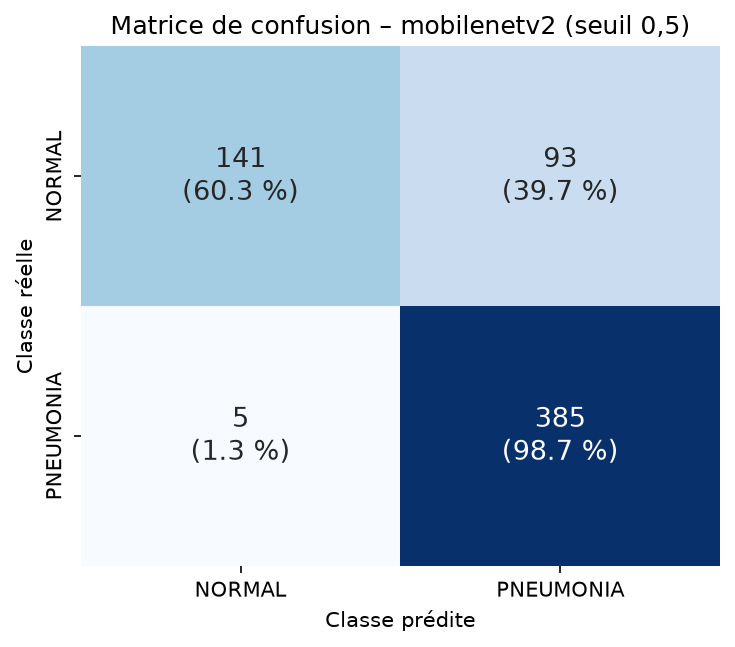

*Figure 6 – Matrice de confusion de MobileNetV2 sur le test (`figures/cm_mobilenetv2.png`).*

Lecture :

- **Recall de 98,7 %** : 385 pneumonies détectées sur 390.
- **Spécificité de 60,3 %** : seules 141 radios normales sur 234 sont reconnues comme normales.
- **Une réponse « normal » est fiable à 96,6 %** (141 sur 146), alors qu'une alerte n'est justifiée que dans 80,5 %
  des cas.
- Les erreurs sont **très déséquilibrées** : 93 fausses alertes pour 5 pneumonies ratées.

| Courbe ROC | Courbe précision-rappel |
|---|---|
| 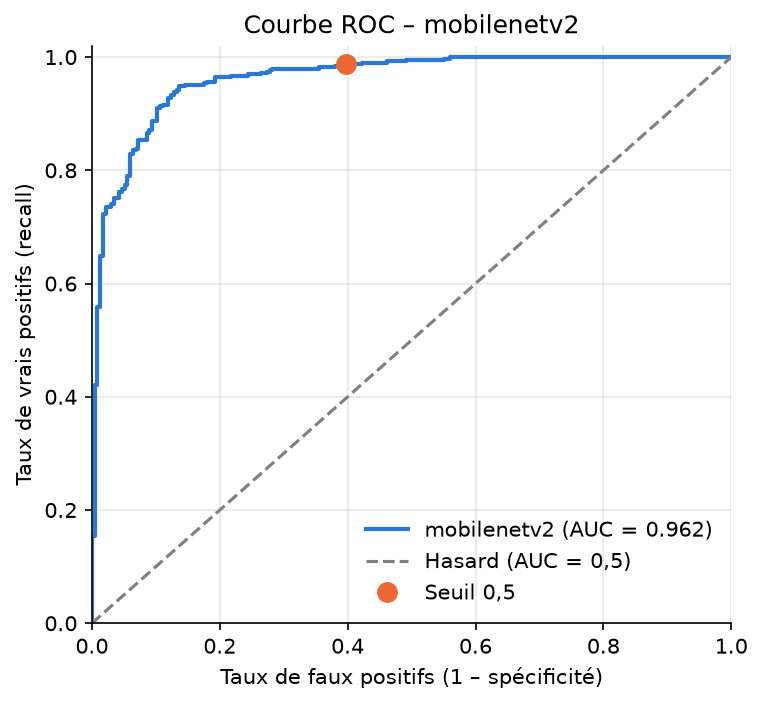 | 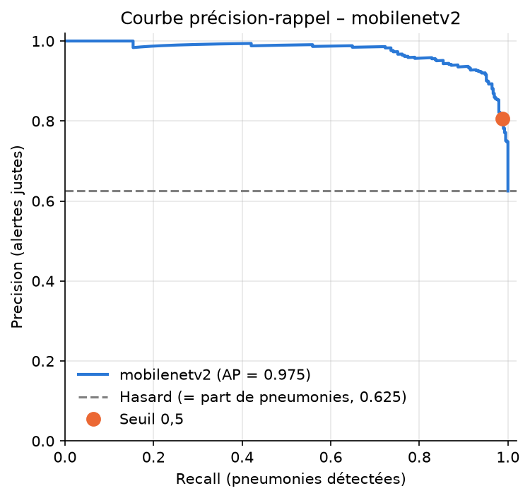 |

*Figure 7 – Courbes ROC (AUC = 0,962) et précision-rappel (AP = 0,975, contre 0,625 pour le hasard) de MobileNetV2.
Le point orange correspond au seuil 0,5.*

L'**AUC de 0,962** indique que le modèle classe bien les radios : dans 96 % des paires (une radio malade, une radio
saine), la malade reçoit la probabilité la plus haute. Le seuil 0,5 se situe dans la partie haute droite de la courbe
ROC : recall maximal, mais beaucoup de fausses alertes.

### 5.4 Effet du seuil de décision

| Seuil | Recall | Precision | Spécificité | Accuracy | Pneumonies ratées | Fausses alertes |
|---|---|---|---|---|---|---|
| 0,3 | 0,992 | 0,782 | 0,538 | 82,2 % | 3 | 108 |
| 0,4 | 0,990 | 0,794 | 0,573 | 83,3 % | 4 | 100 |
| **0,5** | 0,987 | 0,805 | 0,603 | 84,3 % | 5 | 93 |
| 0,6 | 0,982 | 0,822 | 0,645 | 85,6 % | 7 | 83 |
| 0,7 | 0,979 | 0,849 | 0,709 | 87,8 % | 8 | 68 |

Monter le seuil réduit les fausses alertes mais fait rater plus de pneumonies : passer de 0,5 à 0,7 évite 25 fausses
alertes au prix de 3 pneumonies ratées de plus. Calculé à part, un seuil de 0,9 donnerait 16 pneumonies ratées et
45 fausses alertes (accuracy 90,2 %) : l'accuracy augmente, mais on rate trois fois plus de malades.

Nous **gardons le seuil de 0,5** : le choisir en regardant le test rendrait les résultats optimistes, et la validation
(qui serait le bon endroit pour le choisir) est trop facile à cause de la fuite par patient. L'application laisse
l'utilisateur régler ce seuil.

### 5.5 Pourquoi 96 % en validation et 84 % sur le test ?

C'est l'observation la plus importante du projet. Trois causes probables :

1. **La validation est trop facile** : elle partage des patients avec le train (section 3.6).
2. **Le test a une autre proportion de classes** : 62,5 % de pneumonies contre 74,2 % dans le train. Les probabilités
   du modèle sont décalées vers « pneumonie » : la moitié des radios normales du test reçoivent une probabilité
   supérieure à 0,23, et un quart supérieure à 0,78.
3. **Une partie du test semble différente du train** : voir l'analyse des erreurs (section 6.3).

C'est pourquoi les chiffres à retenir sont ceux du test : annoncer 96 % serait trompeur.

---

## 6. Explicabilité

### 6.1 Méthode

Grad-CAM calcule, pour une image, le gradient du score de la classe expliquée par rapport aux cartes de la dernière
couche convolutionnelle. La moyenne des gradients de chaque carte donne son importance ; la somme pondérée des cartes,
après ReLU et normalisation, donne une carte de chaleur de 7×7 (14×14 pour VGG19), agrandie et superposée à la radio.

Deux choix d'implémentation :

- **La carte explique la classe prédite** (pneumonie ou normal), pas toujours la pneumonie.
- **Le gradient est calculé sur le logit** (le score avant la sigmoïde) et non sur la probabilité. Quand le modèle est
  sûr à 100 %, la probabilité vaut exactement 1,0 en float32 et son gradient est nul : la carte est **vide**. Nous
  l'avons vérifié sur la radio la plus confiante de MobileNetV2 (0 case non nulle sur 49) et de VGG19 (0 sur 196) ;
  8 radios du test sont dans ce cas pour VGG19. Le logit ne sature pas, et donne la même carte quand la probabilité
  n'est pas saturée.

### 6.2 Résultats

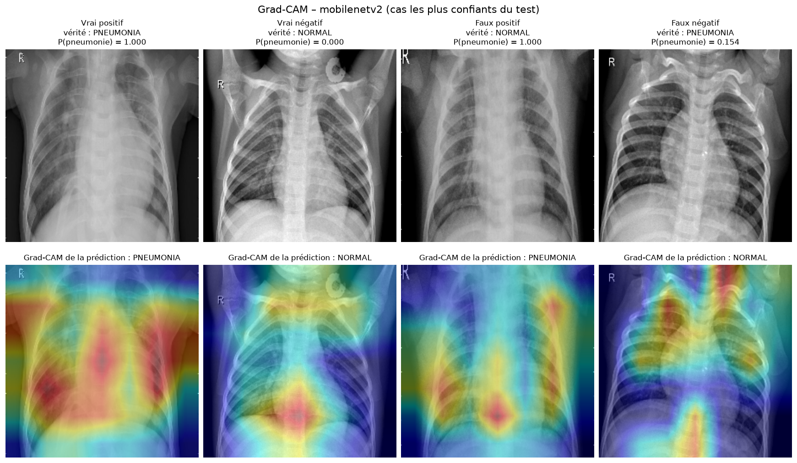

*Figure 8 – Grad-CAM de MobileNetV2 sur les cas les plus confiants du test : vrai positif, vrai négatif, faux positif,
faux négatif (`figures/gradcam_mobilenetv2.png`).*

| Cas (MobileNetV2) | Probabilité | Zones les plus importantes |
|---|---|---|
| Vrai positif | 1,000 | Les deux poumons et le centre du thorax |
| Vrai négatif | 0,000 | Bas du thorax, au centre (cœur, diaphragme) |
| Faux positif | 1,000 | Bas du médiastin et bord du poumon gauche de l'image |
| Faux négatif | 0,154 | Haut du thorax, base du cou, et une zone sous le diaphragme |

Pour aller au-delà de quelques exemples, nous avons calculé la carte des **624 radios du test** et mesuré où tombe la
« chaleur » :

| Zone | Part de la surface | Part de la carte (moyenne) |
|---|---|---|
| Carré central (thorax) | 36 % | **46 %** |
| Bande de 16 pixels le long des bords | 27 % | **17 %** |

MobileNetV2 se concentre plus que le hasard sur le centre, moins sur les bords, et aucune radio n'a plus de la moitié
de sa carte sur les bords. C'est un indicateur grossier (le carré central n'est pas un masque des poumons).

**Comparaison des modèles.** Sur les mêmes radios, les trois modèles ne regardent pas les mêmes zones. Chez **VGG19**,
sur une fausse alerte, la zone la plus rouge recouvre la **lettre « R »** imprimée en haut de la radio. On retrouve le
même comportement dans l'application, sur la radio normale `IM-0001-0001.jpeg` (probabilité 53,8 %). C'est un exemple
du biais « Clever Hans » : le modèle s'appuie en partie sur un indice sans lien avec la maladie. Chez **ResNet50**, la
carte du vrai positif est surtout sur les bords de l'image, en dehors des poumons.

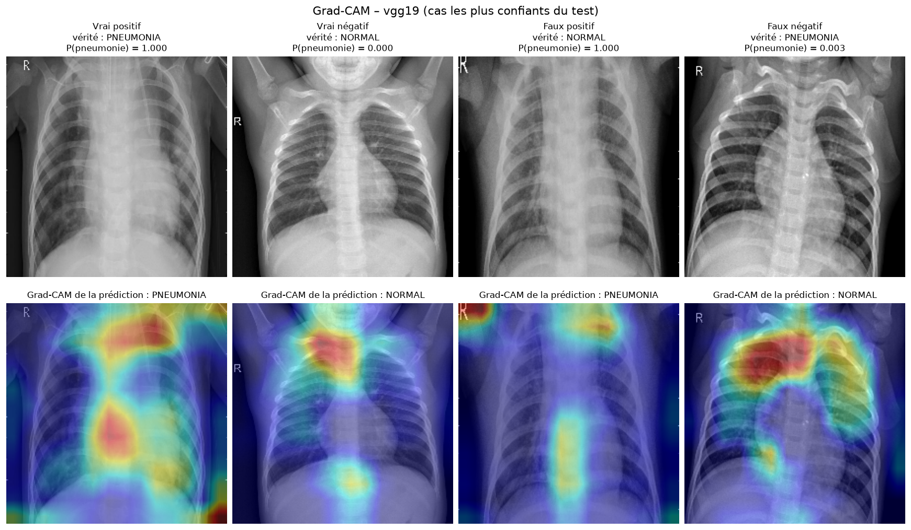

*Figure 9 – Grad-CAM de VGG19 ; sur le faux positif, la lettre « R » est mise en avant (`figures/gradcam_vgg19.png`).*

### 6.3 Analyse des erreurs

**Faux négatifs.** MobileNetV2 n'en fait que 5, toutes des pneumonies bactériennes, avec des probabilités de 0,154 à
0,413. Juger si ces pneumonies sont difficiles à voir demanderait l'avis d'un radiologue.

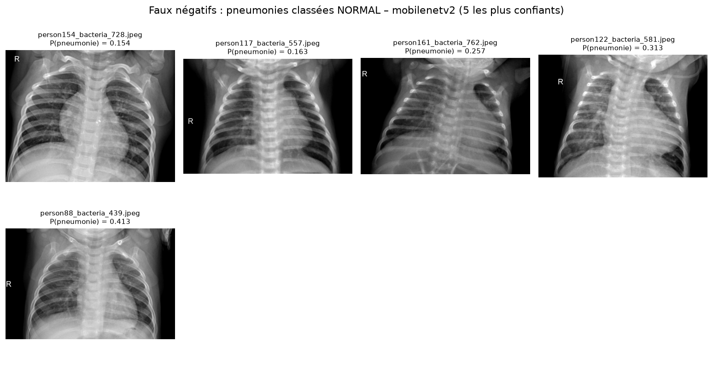

*Figure 10 – Les 5 pneumonies ratées par MobileNetV2 (`figures/erreurs_fn_mobilenetv2.png`).*

**Faux positifs.** Le modèle est presque certain de lui : probabilités de 0,996 à 1,000 pour les 8 plus confiants.
**7 de ces 8 radios ont un nom de fichier en `NORMAL2-`**, et plusieurs portent un marquage « KV58 » ou « KV59 ».
Sur tout le test :

| Radios normales du test | Nombre | Fausses alertes | Taux |
|---|---|---|---|
| Fichiers `IM-…` | 69 | 16 | 23 % |
| Fichiers `NORMAL2-IM-…` | 165 | 77 | **47 %** |

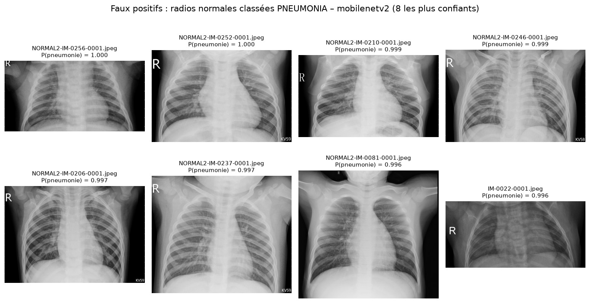

*Figure 11 – Les 8 fausses alertes les plus confiantes de MobileNetV2 (`figures/erreurs_fp_mobilenetv2.png`).*

Les fausses alertes viennent surtout du groupe `NORMAL2`. Le train en contient aussi (633 des 1 147 radios normales),
mais ces radios ont peut-être été acquises dans d'autres conditions. Grad-CAM ne met pas en avant le marquage « KV59 »
chez MobileNetV2 (`figures/gradcam_fp_mobilenetv2.png`) : l'explication tient plutôt à l'aspect général de ces images.

> **Point faible.** L'hypothèse d'un sous-groupe acquis différemment ne peut pas être vérifiée : le dataset ne
> documente pas l'origine des noms de fichiers.

### 6.4 Limites de Grad-CAM

- **Résolution grossière** : une case de la carte couvre 32×32 pixels de la radio ; une petite opacité ne peut pas
  être localisée.
- **Corrélation, pas preuve** : une zone rouge a influencé le score, cela ne veut pas dire qu'elle contient une lésion.
- **Pas de validation médicale** : il faudrait des masques des poumons ou l'avis de radiologues.

---

## 7. Application

### 7.1 Architecture

L'application est écrite avec **Streamlit** (`app/app.py`), qui transforme un script Python en page web. Elle
réutilise les modules du projet :

```
Radio (JPEG/PNG)  →  decoder_image (gradcam.py)   : RGB, 224×224, bilinéaire, comme à l'entraînement
                  →  PREPROCESS[modèle] (data.py) : normalisation propre au modèle
                  →  modèle .keras (mis en cache) : probabilité de pneumonie
                  →  seuil choisi                 : NORMAL / PNEUMONIE
                  →  make_gradcam_heatmap + superposer (gradcam.py) : carte de la classe prédite
```

- **Barre latérale** : choix du modèle (parmi ceux présents dans `models/`) et du seuil (0,10 à 0,90).
- **Page principale** : avertissement médical, chargement d'une radio ou choix d'un exemple du test, radio et carte
  Grad-CAM côte à côte, prédiction en couleur et barre de probabilité.
- Les modèles sont chargés une seule fois grâce à `st.cache_resource`.

**Cohérence avec l'évaluation.** Le code de référence redimensionnait les images avec PIL, qui ne le fait pas
exactement comme le pipeline d'entraînement. Nous utilisons la même fonction de lecture que le pipeline : sur trois
radios du test, l'application affiche exactement les mêmes probabilités que l'évaluation (72,8 %, 2,5 % et 53,8 %).

### 7.2 Captures d'écran

*[À insérer : 3 ou 4 captures d'écran de l'application – pneumonie détectée, radio normale, effet du seuil,
Grad-CAM de VGG19 sur la lettre « R ». Les cas sont décrits dans `docs/etape_7.md`.]*

### 7.3 Tests

Lancement sans image, choix d'exemples, changement de modèle et de seuil, envoi d'un fichier PNG, envoi d'un faux
fichier (message d'erreur clair) : tous les cas ont été testés dans un navigateur, sans erreur.

> **Point faible.** Le modèle répond toujours, même à une image qui n'est pas une radio : une image synthétique en
> dégradé de gris a été classée pneumonie à **100 %**. L'application ne vérifie pas que l'image est une radiographie
> thoracique.

---

## 8. Discussion et limites

### 8.1 Ce qui fonctionne

- Un **recall très élevé** (98,7 %) : le modèle rate très peu de pneumonies sur le test.
- Une **réponse « normal » fiable** (96,6 %).
- Un **classement des radios de bonne qualité** (AUC 0,962), qui laisse une marge de réglage via le seuil.
- Un **modèle léger** (2,26 M de paramètres, environ 10 ms par image sur un processeur ordinaire).

### 8.2 Limites

1. **Une seule source de données** : des radios pédiatriques d'un seul hôpital **[à vérifier]**. Rien ne garantit que
   le modèle fonctionnerait sur des radios d'adultes, d'un autre pays ou d'un autre appareil. Il faudrait le valider,
   et probablement le réentraîner, sur des données locales.
2. **Spécificité faible sur le test** (60 %) : 4 radios normales sur 10 déclencheraient une alerte. En pratique, cela
   surchargerait les médecins.
3. **Écart validation / test** (96 % contre 84 %) : la validation, contaminée par des patients du train, surestime les
   performances. Un découpage **par patient** aurait été préférable.
4. **Sous-groupe `NORMAL2`** : près de la moitié de ces radios normales sont mal classées, sans explication vérifiable.
5. **Indices parasites** : VGG19 s'appuie parfois sur la lettre « R » ; MobileNetV2 regarde parfois le cou ou
   l'abdomen.
6. **Deux classes seulement** : le modèle ne distingue pas les pneumonies bactériennes des virales, ne reconnaît
   aucune autre maladie, et ne sait pas dire « ce n'est pas une radio ».
7. **Un seul entraînement par modèle** et un test de 624 images : les écarts de 1 à 2 points entre modèles ne sont
   pas significatifs.
8. **Seuil non optimisé** : faute de validation fiable, le seuil reste à 0,5.

### 8.3 Ce que nous ferions autrement

- Découper les données **par patient**, pour que la validation reflète vraiment des patients nouveaux.
- Choisir le **seuil sur cette validation**, en fixant un recall minimal (par exemple 95 %) et en maximisant la
  spécificité.
- Répéter chaque entraînement avec **plusieurs seeds** et rapporter la moyenne et l'écart-type.
- Tester le modèle sur un **second dataset**, d'un autre hôpital.

---

## 9. Éthique

- **Outil expérimental, pas un diagnostic.** Le modèle n'a été validé ni cliniquement ni par des médecins.
  L'application l'affiche clairement. La décision appartient au médecin.
- **Responsabilité.** Un faux négatif peut retarder un traitement ; un faux positif peut entraîner des examens ou des
  antibiotiques inutiles. Le choix du seuil est un choix médical, pas seulement technique.
- **Biais.** Un modèle entraîné sur une population (enfants, un hôpital, un pays) peut être moins performant sur une
  autre, et donc défavoriser des patients qui ne ressemblent pas aux données d'entraînement.
- **Confidentialité.** Les radiographies sont des données de santé, particulièrement protégées (par exemple par la
  loi 09-08 au Maroc et le RGPD en Europe **[à vérifier]**). Le dataset utilisé est public et anonymisé. L'application
  fonctionne **en local** : les images chargées ne quittent pas la machine.
- **Transparence.** Grad-CAM aide à comprendre les décisions, mais il ne doit pas donner une fausse impression de
  fiabilité : une carte « jolie » ne prouve pas que le raisonnement est correct.

---

## 10. Conclusion et perspectives

Nous avons construit une chaîne complète de détection de pneumonie sur radiographies thoraciques : préparation des
données, transfer learning en deux phases sur trois architectures, évaluation sur un test set indépendant,
explicabilité et application de démonstration. Les trois modèles obtiennent des résultats équivalents ; MobileNetV2,
le plus léger, détecte 98,7 % des pneumonies du test avec une AUC de 0,962, au prix de nombreuses fausses alertes
(spécificité de 60 %).

Le projet montre surtout que **le chiffre affiché dépend fortement de la façon dont on évalue** : 96 % en validation,
84 % sur le test. Il montre aussi l'utilité de l'explicabilité, qui révèle des appuis sur des zones sans intérêt
médical.

**Perspectives :**

- **Plus de données**, de plusieurs hôpitaux, d'enfants et d'adultes, avec un découpage par patient.
- **Classification multi-classes** : normal, pneumonie bactérienne, pneumonie virale (l'information existe dans les
  noms de fichiers du dataset).
- **Réglage du seuil** sur une validation propre, selon un objectif de recall.
- **Détection des images hors sujet** avant la prédiction.
- **Déploiement mobile** : MobileNetV2 peut être converti en TensorFlow Lite pour fonctionner sur un téléphone.
- **Validation par des radiologues** des prédictions et des cartes Grad-CAM.

---

## Références

*À compléter et vérifier (auteurs, titre, revue, année) avant le rendu :*

1. Kermany, D. S. et al. *Identifying Medical Diagnoses and Treatable Diseases by Image-Based Deep Learning.* Cell, 2018.
2. Rajpurkar, P. et al. *CheXNet: Radiologist-Level Pneumonia Detection on Chest X-Rays with Deep Learning.* arXiv, 2017.
3. Selvaraju, R. R. et al. *Grad-CAM: Visual Explanations from Deep Networks via Gradient-based Localization.* ICCV, 2017.
4. Sandler, M. et al. *MobileNetV2: Inverted Residuals and Linear Bottlenecks.* CVPR, 2018.
5. He, K. et al. *Deep Residual Learning for Image Recognition.* CVPR, 2016.
6. Simonyan, K. et Zisserman, A. *Very Deep Convolutional Networks for Large-Scale Image Recognition.* ICLR, 2015.
7. Deng, J. et al. *ImageNet: A Large-Scale Hierarchical Image Database.* CVPR, 2009.
8. Zech, J. R. et al. *Variable generalization performance of a deep learning model to detect pneumonia in chest
   radiographs: A cross-sectional study.* PLOS Medicine, 2018.
9. Organisation mondiale de la santé. *Pneumonie* (fiche d'information).
10. Dataset Kaggle : *Chest X-Ray Images (Pneumonia)*, P. Mooney, `paultimothymooney/chest-xray-pneumonia`.

---

## Annexe – Récapitulatif des points faibles qu'un jury pourrait relever

| Point faible | Où il est traité | Réponse courte |
|---|---|---|
| Accuracy de 84 % « seulement » | 5.2, 5.5 | Le recall (98,7 %) est la métrique clé ; l'accuracy est tirée vers le bas par les fausses alertes |
| 96 % en validation, 84 % au test | 5.5 | Validation contaminée par des patients du train ; on annonce le chiffre du test |
| Fuite par patient dans la validation | 3.6 | Mesurée (362 patients sur 467) ; le test n'est pas concerné |
| Spécificité de 60 % | 5.3, 8.2 | Seuil non optimisé ; compromis montré dans le tableau des seuils |
| Fine-tuning sans effet sur le test | 5.2 | Arrêt très précoce, learning rate faible ; décalage de données non corrigeable ainsi |
| Un seul entraînement par modèle | 4.4 | Écarts entre modèles non significatifs ; plusieurs seeds en perspective |
| Choix du modèle sur le test | 5.2 | Scores à égalité, choix fondé sur la taille et la vitesse |
| Grad-CAM sur la lettre « R » (VGG19) | 6.2 | Biais « Clever Hans » identifié et discuté |
| Image non radiologique classée pneumonie à 100 % | 7.3 | Limite assumée ; détection des images hors sujet en perspective |
| Données d'un seul hôpital pédiatrique | 8.2 | Généralisation non garantie ; validation sur données locales nécessaire |
| Temps d'inférence mesuré sur un seul PC | 5.2 | Ordre de grandeur, utile pour comparer les modèles entre eux |
